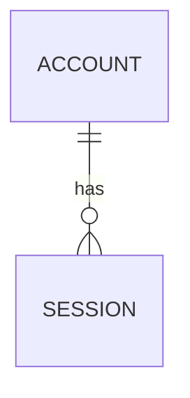

# BFAST Technical Design Documents

An epic or a story often needs more than one description. The data model behind a
sign-in story, the call sequence its acceptance criteria assume, the context diagram a
reviewer asks for — each is a document in its own right, and none of them belongs
squeezed into the ticket's description.

So a board for an **epic** or a **story** grows tabs. Press **+** on the tab bar, pick a
**style**, give it a title, and the ticket gains a technical design document: a markdown
file whose [mermaid](https://mermaid.js.org) diagrams are drawn in the tab rather than
shown as source. It starts empty, with the **AI assistant** open and asking what it should
say — the ticket is already in front of it — or you press **Edit** and write it yourself.
Three styles ship — **Entity-Relationship Diagram**, **Sequence Diagram** and **Low Level
Design** — and a workspace adds its own as design skills. The first two are one picture
each; the third is deliberately free-form, and the shape of a document is the style's own
business (see [configuration.md](configuration.md)).

This folder is the feature's specification and user guide:

- [configuration.md](configuration.md) — styles as design skills: the folder, the frontmatter, adding one

## A design document is not a ticket

It never appears in the sidebar tree, never comes back from `listSummaries`, never
carries a status, and never reaches a test report. It is a file *belonging to* a ticket,
the way `assets/` holds the images a description references. Everything that follows
falls out of that one sentence.

## Where they live

Beside the ticket's own content file, in the ticket's folder:

```
ST-1.2-Sign_in_with_email/
  Story.mdx            metadata.yaml     history.md
  ERD-1-Account_model.mdx
  SEQ-1-Login_flow.mdx
  SEQ-2-Password_reset.mdx
  assets/
```

**The file name is the tab.** It is `<PREFIX>-<ordinal>-<Slug>.mdx`, the same grammar a
ticket folder uses: the style's prefix, an ordinal counted **per style within that
ticket**, and the title slugified. `ERD-1` is the document's id, and it is what the board
persists when it remembers which tab you were on.

Flat files rather than a `designs/` subfolder, for three reasons that are all mechanical:

- The tracker reads a level by listing **directories**. A `.mdx` is never a candidate
  ticket, so a design document costs the scanner nothing and can never be mistaken for one.
- A ticket's `hasChildren` — what draws the expander arrow in the sidebar — counts
  subdirectories. A `designs/` folder would put an expander on every epic and story that
  opened to nothing.
- Renaming a ticket rewrites only its folder's slug, and deleting one removes the folder.
  Design documents move and die with their ticket without a line of code.

The prefix is therefore load-bearing, and a style may not claim `EP`, `ST`, `AC` or `TC`
— those are the ticket prefixes, and a folder name is parsed by the same shape.

## What is in one

A flat frontmatter block, then markdown:

```md
---
title: Account model
style: entity-relationship-diagram
createdBy: ada
createdAt: 2026-09-06T10:00:00.000Z
updatedAt: 2026-09-06T10:04:11.480Z
---

Every session belongs to exactly one account.


```

The frontmatter is read by the same flat `key: value` reader `metadata.yaml` and every
`SKILL.md` use — no nesting, no lists. Two consequences worth knowing: a `title`
containing a colon survives (the first colon is the separator, the rest is the value),
but a hand-typed `title: Checkout # 2` loses its tail to the comment strip unless it is
quoted. Exactly as in `metadata.yaml`.

**`updatedAt` is the document's own.** It is the optimistic-concurrency token: the board
sends back the one it last saw, and a save is refused when disk has moved on. It is
deliberately *not* the ticket's — sharing that one would make saving a diagram fail the
next save of a description someone had open mid-edit.

## Reading is forgiving, writing is strict

| Situation | What happens |
|---|---|
| No frontmatter at all | Still loads. The title comes from the slug, the style from the file-name prefix |
| `style` disagrees with the prefix | The **file name wins**; the next write heals the frontmatter |
| `style` names a style no role holds any more | Still loads, under a style synthesised from the prefix — the tab stays, it just leaves the **+** menu |
| Unparseable mermaid | The document loads and edits normally; the diagram area shows the parser's message |
| Creating one on an acceptance criterion or a test case | **Refused.** A design belongs to an epic or a story |
| A skill whose prefix collides, or is a ticket prefix | The style is **not offered**, and the settings form names the skill |
| Saving with a stale `updatedAt` | **Refused** as a conflict, the way a description edit is |

## What it writes into the ticket

One line of history, and nothing else:

```
## 2026-09-06T10:04:11.480Z — ada — designed

> Updated the "Account model" entity-relationship diagram.
```

No status change — Run Tests owns `done` and `blocked`, and two features writing one
field would fight. **No `updatedAt` bump** either: a ticket's `updatedAt` moving would
fail the next save of a board someone had open mid-edit on Description, which is exactly
the trap attaching an image already avoids.

Deleting a document sends the file to the trash, falling back to a permanent delete where
the file system has no trash.

## Writing one with the AI assistant

The **AI Assistant** button works on a design tab the way it works on a description: pick
an agent, optionally type an instruction, press Generate. What differs is which skill runs
and what the agent is told.

A design run is driven by a **design skill** — a third kind beside `write` and `plan`,
and the same file that *declares* the style (see [configuration.md](configuration.md)).
A design skill is keyed by **style**, not by ticket type: `design-sequence-diagram` shapes
a sequence diagram whether it hangs under an epic or a story. For a built-in style every
role is offered, drawing with its own copy of the skill or with the shipped one; for a
style the workspace declared, only the roles holding its skill are — there is nothing
to fall back on — and the assistant says which to add in Settings → Design.

The run is given the ticket, its parent, and **the document as it currently stands**, so
pressing Generate a second time refines rather than restarts.

### Continuing the previous conversation

That is context, not memory. On its own, a second press is a *new* Claude conversation
that happens to be handed the current diagram — it has forgotten why it drew what it drew,
and what you told it last time.

So once a run has spoken about a document, the assistant offers **Continue the previous
conversation**, ticked, with when it last spoke. Ticked, the follow-up you type is asked in
that same conversation: "make the payment step async" needs no restating of what the
diagram is. Unticked, the run starts fresh.

Four rules, each of which you can see:

- **One conversation per document.** The ERD and the sequence diagram on one story are
  separate conversations, and switching tabs switches which one is offered.
- **The document goes in either way.** A conversation remembers what it was told, not what
  the file says now — it may have been edited by hand, or in another window, since the run
  spoke — so the current body is always in the prompt and the answer always replaces it in
  full.
- **Only the provider that ran it.** A session id belongs to the Claude CLI or to the Agent
  SDK, and one handed to the other resolves to nothing, so switching `ai.provider` simply
  stops offering the old conversation.
- **It is remembered on this machine only.** The id is kept in the window's workspace state,
  never in the ticket folder: a Claude session is a file under `~/.claude/projects/`, so a
  committed id would resolve to nothing on a teammate's machine. Nothing is offered after
  the session is gone from disk either — a resume that fails says so, and the fix is to
  untick and run fresh rather than have BFAST guess.

Two limits are the same as everywhere else in BFAST:

- The agent reads the repository, and may edit only the description file of *another*
  existing ticket when you ask it to — never the document it is writing, never a ticket's
  `metadata.yaml` or `history.md`, never a file it would have to create. Every such edit is
  recorded in that ticket's history with the run's provenance, and the board tells you it
  happened. A board open mid-edit on that ticket sees the usual "changed on disk" notice.
- The result lands in the **draft**, never on disk. A run takes minutes, and a document
  that arrived while you were editing would otherwise silently overwrite you.

### A note on which roles are offered

On a description, the picker offers the roles that write the ticket's type. On a design
tab it offers the roles that can draw the style — every role for a built-in one — because
a design skill deliberately does not add ticket types to its role: otherwise seeding one
would quietly make a role claim it could write stories. So Solution Architect, which
writes epics and acceptance criteria, is offered for a sequence diagram on a story board
even though it is not offered for the story's own description.
