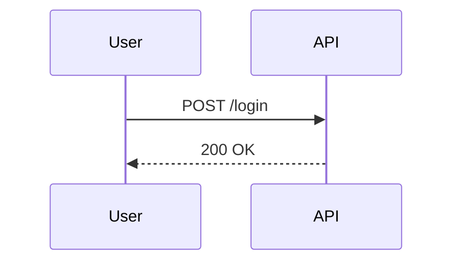

# The board

The board is the editor tab for one ticket. Its tab title is the ticket's full id and title —
`ST-1.2 Sign in with email` — and its icon shows the ticket's type and status.


There is **one board per ticket**. Opening a ticket that already has a board reveals that tab.
Boards come back after a window reload, on the tab you left.

## Open a board

| From | Do |
|---|---|
| The tree | Click a ticket for a preview tab (italic title), double-click to pin it |
| The Tickets title bar | **Open Board** returns to the board you last used |
| A new ticket | Its board opens by itself, pinned |
| A Tests tab | Click a test case's key to open that test case's board |


A preview tab is replaced by the next ticket you single-click. As soon as you start working in
it — **Edit**, **Save**, the AI assistant, a test run — it is pinned, like a file you start
typing in.

## What is on a board

From top to bottom:

1. **The header** — the type badge (`ST`), the ticket's key (`ST-2`), its type, the **status
   pill** (*In progress*) and the assignee (*sam*, or *Unassigned*).
2. **The title**.
3. **The tab bar** — the tabs below, then on the right:
   - **+** — *New design document*, on epics and stories only,
   - **AI Assistant**,
   - **Edit**.
4. **The tab's content**.

| Tab | Shows | On |
|---|---|---|
| **Description** | The ticket's markdown description, then its **Linked tickets** — see [Link tickets](./tickets.mdx#link-tickets) | every ticket |
| **History** *n* | Every change made to the ticket; *n* is the number of entries | every ticket |
| **Tests** | Test runs, videos and traces — see [Run tests](./run-tests.mdx) | every ticket |
| One per **design document** | An ERD, sequence diagram or other design — see [Design documents](./design-documents.mdx) | epics and stories |

To change the status, use **Set Status…** on the ticket in the tree; to change the title, use
**Rename…**. The board edits the description.

## Edit the description

1. Open the ticket's board and stay on the **Description** tab.
2. Click **Edit**. The rendered description becomes a text area holding its markdown, with a
   toolbar above it.
3. Write markdown, using the toolbar or typing it directly.
4. Click **Save** (or press **Ctrl+Enter**) to write it to disk. Click **Cancel** (or press
   **Esc**) to discard the draft.


Saving writes the ticket's `.mdx` file, bumps its `updatedAt`, and adds a *changed description*
entry to its history.

### The toolbar

| Control | Markdown |
|---|---|
| Text level: Normal, Heading 1–6 | `#` … `######` |
| **B** Bold (`Ctrl+B`) | `**text**` |
| *I* Italic (`Ctrl+I`) | `*text*` |
| U̲ Underline (`Ctrl+U`) | `<u>text</u>` |
| Bulleted list | `- item` |
| Insert image | `` |

Inline controls wrap the selection. The text level and the bullet toggle act on whole lines
and are mutually exclusive: making a line a heading removes its bullet, and the reverse. The
picker and the bullet button show the state of the line the caret is on. Each toolbar click is
one undo step (`Ctrl+Z`).

### Images

Three ways to add an image while editing, all ending in the ticket's own `assets/` folder:

1. Click **Insert image** in the toolbar and pick a file.
2. Paste an image from the clipboard into the text area.
3. Drag a file from your desktop or from the VS Code explorer onto the text area.

The image is copied into `<ticket folder>/assets/` and a reference such as
`` is inserted at the caret. The ticket folder stays
self-contained, so the image moves and is deleted with its ticket.

### What renders

Standard markdown, with a single newline shown as a line break.

- A fenced block labelled `mermaid` is **drawn as a diagram**.
- HTML is shown as characters, not rendered. `<u>` is the one exception.
- Links are limited to safe schemes.
- Remote images are named, not fetched, so opening a ticket never contacts another server.

````md

````

## When the file changes underneath you

BFAST watches the tracker. If a ticket changes on disk — a `git pull`, a teammate's commit, an
edit in a text editor, an AI run — the board reloads.

If you are **in the middle of editing**, your draft is kept and a notice tells you the file
changed. When you then save, BFAST refuses to overwrite the newer version silently. To recover:

1. Copy your text out of the text area.
2. Click **Cancel**. The board shows the newer description.
3. Click **Edit**, re-apply your change on top of it, and **Save**.

This check is why a save can never discard someone else's change.

## History

The **History** tab lists every change to the ticket, **newest first**: who, what, and when.

1. Click **History**.
2. For a description change, click **See before and after** to expand the old and the new text.


Typical entries are *created*, a status change shown as `from → to`, a description change with
the old and new text, a *designed* entry for a design document, and a code scan's verdict.

History is append-only and stored in the ticket's `history.md`. Changes made by the AI
assistant are recorded under **your** name — you pressed Save — with a comment naming the
agent, model and cost.

## AI Assistant

The **AI Assistant** button opens a panel that writes the description for you. Its tooltip says
why when it is unavailable — usually that the `claude` CLI could not be found. See
[AI assistant](./ai-assistant.mdx).
