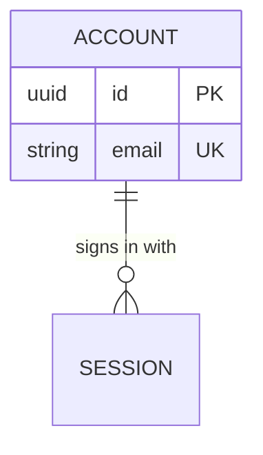

# Design documents

An epic or a story can carry technical design documents — an entity-relationship diagram, a
sequence diagram, a low level design. Each is a markdown file with
[Mermaid](https://mermaid.js.org/) diagrams, stored in the ticket's folder and shown as its own
tab on the ticket's board.


## Built-in styles

| Style | File prefix | Shape |
|---|---|---|
| Entity-Relationship Diagram | `ERD` | One `erDiagram` |
| Sequence Diagram | `SEQ` | One `sequenceDiagram` |
| Low Level Design | `LLD` | Free-form: prose, tables, and any number of diagrams |

Acceptance criteria and test cases have no design tabs.

## Create a document with the AI assistant

This example draws the sign-in flow on the **Authentication** epic.

1. Open the board of an epic or a story.
2. Click **+** on the tab bar, just left of **AI Assistant**. The **New design** menu opens.
3. Pick a style — **Sequence Diagram** — and type a title, such as `Sign in`.
4. Click **Create**.

   

5. A new tab named after the document opens. The document is **empty**, and the AI assistant is
   already open with the style's skill selected — here *Design sequence diagram*. Every role is
   offered for a built-in style.
6. Describe what the diagram should show — the participants, the paths that matter — and click
   **Generate**.

   

7. When the run finishes, the answer opens in the editor. Check it, then click **Save**.

   

8. The tab now shows the drawn diagram.

   

## Create a document by hand

Follow steps 1–4 above, then click **Close** on the assistant panel and **Edit** in the
document's header. Write the Mermaid yourself and click **Save**.

````md title="ERD-1-Account_model.mdx (body)"

````

## Refine a document

1. Open the document's tab and click **AI Assistant**.
2. Type what should change, such as `Also show the password-reset link offered after a
   lockout.`
3. Leave **Continue the previous conversation** ticked. It appears when the same provider ran
   the last request for this document, and resumes that conversation, so the agent refines its
   diagram instead of starting over. Each document has its own conversation.
4. Click **Generate**.


The current document is sent with every request either way, so a hand edit made since the last
run is not lost. An answer over existing content is shown as a diff with **Approve**,
**Rewrite** and **Cancel**, as on the
[description tab](./ai-assistant.mdx#rewrite-an-existing-description).

If resuming fails — the conversation was on another machine, for example — untick the box and
run again.

## Rename or delete

The document's header has **Edit**, **Rename** and **Delete**. Renaming changes the title and
the file's slug; the prefix and number stay.

## Where they live

Documents are files beside the ticket's description, named
`<PREFIX>-<number>-<Slug>.mdx`. The number is counted per style within the ticket.

```text
EP-1-Authentication/
  Epic.mdx
  ERD-1-Account_model.mdx
  SEQ-1-Sign_in.mdx
```

Each file starts with a small frontmatter — `title`, `style`, `createdBy`, `createdAt`,
`updatedAt` — followed by the markdown.

They move with the ticket when it is renamed and are deleted with it. Each write adds one
`designed` entry to the ticket's **History**. Saving a design does not count as a change to the
ticket itself, so it cannot conflict with someone editing the description.


## Manage styles in the settings form

**Settings → Design** lists every style. For each one you see its prefix, whether it is built
in, and the roles that hold its skill, each with **Skill** and **Expected output** buttons
that open the two files.


Nothing on this tab is written to `bfast.json`: a style *is* its skill files.

### Add your own style

1. Open **Settings → Design** and click **New style…**.
2. Pick the role that draws it.
3. Type what it is called — `C4 Context`.
4. Confirm its id — prefilled from the name, `c4-context`.
5. Confirm the prefix its files take — prefilled from the initials, such as `CC`; type `C4`.

BFAST scaffolds the skill folder and opens `SKILL.md`. Describe how to draw the diagram there,
and put an example in `resources/expected-output.md`.

```md title=".bfast/agents/solution-architect/design-c4-context/SKILL.md"
---
name: design-c4-context
description: One C4 context diagram, as one mermaid C4Context.
kind: design
style: c4-context
label: C4 Context
prefix: C4
types: epic, story
---

Draw one C4 context diagram…
```

| Key | Rules |
|---|---|
| `style` | Lower-case letters, digits and hyphens. The folder must be named `design-<style>`. |
| `label` | What the **+** menu shows. Defaults to the style in title case. |
| `prefix` | 1–8 upper-case letters or digits, starting with a letter. Must be unique, and may not be `EP`, `ST`, `AC` or `TC`. |
| `types` | `epic`, `story` or both |

As soon as the folder exists, every epic and story board offers the style on **+**.

### Which roles can draw a style

- **Built-in styles:** every role. A role without its own copy of the skill uses the one
  shipped with BFAST.
- **Your own styles:** only the roles that hold the skill. Click **Add to a role…** on the
  style's card and pick a role to copy the skill to it.

Giving a role its own copy of a built-in skill is also how you change how that role draws it.

### Rules every style must keep

- Each diagram goes in its own `mermaid` fence.
- The answer must not be wrapped in an outer code fence.

### Remove a style

Delete its folder from every role that holds it. Existing documents keep working — they open,
edit and save — but the style leaves the **+** menu. A built-in style cannot be removed.

## Over MCP

With the `designs` function switched on, an MCP client can list, read, create and rewrite
design documents. See [MCP server](./mcp-server.mdx).
